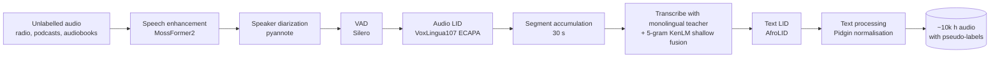

# Sometin Beta Pass Notin (SBPN)

**Improving Multilingual ASR for Nigerian Languages via Knowledge Distillation**

[](https://arxiv.org/abs/2605.17710)
[-yellow)](https://huggingface.co/ogunlao/SBPN_multilingual_base)
[-yellow)](https://huggingface.co/ogunlao/SBPN_multilingual_large)
[](https://creativecommons.org/licenses/by-nc-sa/4.0/)

*Sometin Beta Pass Notin* is a Nigerian Pidgin expression meaning **"something is better than nothing"**. The name reflects the idea behind the work: learning from several average teachers can still produce a good student.

SBPN is a family of multilingual foundational ASR models for **Yorùbá (yo), Hausa (ha), Igbo (ig), Nigerian Pidgin (pcm) and Nigerian English (en-ng)**. They were trained by distilling existing monolingual models, each paired with a language-specific N-gram LM, into a single multilingual student. The student was then refined through iterative pseudo-label self-improvement.

This repository holds the paper's resources: the extra appendix, the Nigerian Pidgin normalisation lists in machine-readable form, and scripts for inference and text normalisation.

## Highlights

- **29% average relative WER reduction** over the monolingual teacher models (16% even when the teachers use N-gram LM fusion).
- **SBPN-Large (600M) beats Whisper Large, MMS-1B and SeamlessM4T v2** on average on the FLEURS Nigerian-language test sets: 21% relative WER reduction over MMS-1B, the next best model.
- **SBPN-Base (120M)** cuts WER by 60% relative to AfriHuBERT and by 63% relative to mHuBERT-147 on Common Voice.
- **60% relative WER reduction on Nigerian Pidgin** over the teacher model.
- **Built-in language identification**: every transcript starts with a language tag. SBPN reaches ≥ 96.5 F1 on all five languages, including Nigerian English and Pidgin, which existing LID models handle poorly.
- **Robust to fast speech**: WER stays stable up to 2× speaking rate, while the monolingual teachers degrade sharply.

## Models

| Model | Params | Architecture | Encoder initialisation | Link |
|---|---|---|---|---|
| SBPN-Base | 120M | FastConformer hybrid RNNT + CTC (17 layers, d=512) | [`nvidia/parakeet-tdt_ctc-110m`](https://huggingface.co/nvidia/parakeet-tdt_ctc-110m) | [🤗 ogunlao/SBPN_multilingual_base](https://huggingface.co/ogunlao/SBPN_multilingual_base) |
| SBPN-Large | 600M | FastConformer hybrid RNNT + CTC (24 layers, d=1024) | [`nvidia/parakeet-tdt-0.6b-v3`](https://huggingface.co/nvidia/parakeet-tdt-0.6b-v3) | [🤗 ogunlao/SBPN_multilingual_large](https://huggingface.co/ogunlao/SBPN_multilingual_large) |

Both models take **16 kHz mono audio** and output a transcript prefixed with a language tag: `<|en|>`, `<|yo|>`, `<|ha|>`, `<|ig|>` or `<|pd|>` (Nigerian Pidgin).

## Quickstart

### Install

Install [PyTorch](https://pytorch.org/get-started/locally/) first, then the requirements ([NVIDIA NeMo](https://github.com/NVIDIA/NeMo) and librosa):

```bash
git clone https://github.com/ogunlao/sometin-beta-pass-notin.git
cd sometin-beta-pass-notin
pip install -r requirements.txt
```

### Transcribe a .wav file: transcript + language

The command line:

```console
$ python sbpn.py sample.wav
Language:   Nigerian Pidgin (pcm)
Transcript: how body dey
```

Or from Python, with [`sbpn.py`](sbpn.py):

```python
from sbpn import SBPN

model = SBPN()                       # SBPN-Large (600M). SBPN("base") for the 120M model
result = model.transcribe("sample.wav")

result.text           # "how body dey"
result.language       # "pcm"  -> one of: en, yo, ha, ig, pcm
result.language_name  # "Nigerian Pidgin"
```

Pass a list of files to get a list of results: `model.transcribe(["a.wav", "b.wav"])`. Audio at any sample rate, mono or stereo, is resampled to the 16 kHz mono input the model expects.

### Using NeMo directly

> **Note:** the checkpoints were trained with Graph RNNT loss, so a plain `from_pretrained` fails with `Could not import k2` unless [k2](https://k2-fsa.github.io/k2/installation/index.html) is installed. `sbpn.py` avoids this by switching to NeMo's default RNNT loss at load time; the loss is never used at inference. To do the same yourself:
>
> ```python
> from omegaconf import open_dict
> cfg = nemo_asr.models.EncDecHybridRNNTCTCBPEModel.from_pretrained("ogunlao/SBPN_multilingual_large", return_config=True)
> with open_dict(cfg):
>     cfg.loss = {"loss_name": "default"}
> asr_model = nemo_asr.models.EncDecHybridRNNTCTCBPEModel.from_pretrained("ogunlao/SBPN_multilingual_large", override_config_path=cfg)
> ```

```python
import re
import nemo.collections.asr as nemo_asr

asr_model = nemo_asr.models.EncDecHybridRNNTCTCBPEModel.from_pretrained(
    model_name="ogunlao/SBPN_multilingual_large"  # or "ogunlao/SBPN_multilingual_base"
)

output = asr_model.transcribe(["audio_sample_in_pidgin_english.wav"])
prediction = output[0].text

# Language identification: the first token is the language tag, e.g. "<|pd|>"
language_id = prediction.split()[0]

# Transcript without the language tag
transcript = re.sub(r"<.*?>", "", prediction).strip()
```

### Batch transcription

For many files or whole directories, use [`scripts/transcribe.py`](scripts/transcribe.py):

```bash
python scripts/transcribe.py clips/ --model base --batch-size 8  # a whole directory with SBPN-Base
python scripts/transcribe.py clips/ --output results.jsonl       # {"audio", "language", "text"} per line
```

## Method

<p align="center"><b>Pseudo-label generation pipeline</b></p>



1. **Data curation.** About 4.7k hours of labelled speech (see below) and about 10k hours of processed unlabelled speech.
2. **N-gram LMs.** One 5-gram KenLM per language, built from training labels, CC-100 and language-specific text corpora. Each LM is fused with an open-source monolingual CTC teacher ([Hausa](https://hf.co/CLEAR-Global/w2v-bert-2.0-hausa_579_993h_yourtts), [Igbo](https://hf.co/CLEAR-Global/w2v-bert-2.0-igbo_naijavoices_500h), [Yorùbá](https://hf.co/CLEAR-Global/w2v-bert-2.0-yoruba_naijavoices_500h), [Pidgin](https://hf.co/asr-nigerian-pidgin/pidgin-wav2vec2-xlsr53)) through the Flashlight decoder to produce pseudo-labels.
3. **Knowledge distillation (Stage 1).** SBPN-Large is trained on pseudo-labelled and ground-truth data together, then refined on ground-truth data alone.
4. **Self-improvement (Stage 2, two iterations).** The student re-labels the unlabelled audio using LM fusion. Each language gets its own confidence threshold, and any pseudo-label whose language tag disagrees with the target language is discarded.
5. **SBPN-Base** is distilled from SBPN-Large's pseudo-labels, using target-language forcing among the beam hypotheses.
6. **Nigerian Pidgin orthographic normalisation.** Pidgin has no standard orthography. Variants were clustered by aligning English-ASR and Pidgin-ASR outputs with the reference transcripts, then mapped to the most frequent form ([Appendix A](paper/SBPN_appendix.pdf)). Context-dependent homophones were resolved with the Pidgin N-gram LM ([Appendix B](paper/SBPN_appendix.pdf)). Test sets were left unnormalised.

<details>
<summary><b>Training hyperparameters (Table III)</b></summary>

| Parameter | SBPN-Base | SBPN-Large |
|---|---|---|
| Encoder layers / hidden dim | 17 / 512 | 24 / 1,024 |
| LSTMs in prediction network | 1 | 2 |
| Attention heads | 8 | 8 |
| Vocabulary (SentencePiece) | 4,096 | 4,096 |
| Log-Mel bins | 80 | 120 |
| RNNT loss | Graph RNNT | Graph RNNT |
| Base / self-improvement LR | 1e-4 / 1e-5 | 3e-4 / 1e-5 |
| Weight decay | 1e-4 | 1e-4 |
| CTC loss weight | 0.3 | 0.3 |
| Global batch size | 320 | 240 |
| Language sampling temperature | 20 | 20 |
| Beam size | 100 | 100 |
| Checkpoint averaging | Last 3 | None |
| Precision | BF16-mixed | BF16-mixed |

Augmentation (distillation → self-improvement): SpecAugment; MUSAN noise p = 0.4 → 0.25 (SNR 5–30 dB); time stretching {0.9, 1.0, 1.1, 1.2} p = 0.4 → 0.25. Optimiser: AdamW, 2,500 warm-up steps, cosine annealing.

</details>

## Training data

| Dataset | Languages | Hours |
|---|---|---:|
| [Common Voice](https://commonvoice.mozilla.org/) | yo, ha, ig, en-ng | 13.5 |
| [NaijaVoices](https://huggingface.co/datasets/naijavoices/naijavoices-dataset) | yo, ha, ig | 1,862.0 |
| [FLEURS](https://huggingface.co/datasets/google/fleurs) | yo, ha, ig | 37.4 |
| [SLR86](https://openslr.org/86/) | yo | 4.0 |
| BibleTTS | yo, ha | 111.7 |
| Igbo-asr | ig | 23.2 |
| [Nigerian Pidgin dataset](https://huggingface.co/datasets/asr-nigerian-pidgin/nigerian-pidgin-1.0) | pcm | 5.4 |
| [AfriSpeech-200](https://huggingface.co/datasets/intronhealth/afrispeech-200) | en-ng | 172.4 |
| GigaSpeech-L | en | 2,483.9 |
| **Total labelled** | | **4,713.5** |

In addition, about 10,000 hours of pseudo-labelled audio were drawn from radio shows, podcasts, audiobooks and other permissively licensed sources.

## Results

### Teacher vs. student: WER (%), FLEURS and Nigerian Pidgin test sets

| | en-ng | ha | ig | yo | pcm | Avg |
|---|---:|---:|---:|---:|---:|---:|
| Monolingual teachers | 25.30 | 31.04 | 38.68 | 55.60 | 32.44 | 36.61 |
| + N-gram LM | – | 26.26 | 34.18 | 43.77 | 20.09 | 31.08 |
| SBPN-Large, Stage 1 (KD) | 21.09 | 24.47 | 35.15 | 41.06 | 13.19 | 26.99 |
| **SBPN-Large, Stage 2 (SI)** | **19.36** | **24.38** | **33.86** | **39.94** | **12.94** | **26.10** |

The en-ng teacher is Parakeet-TDT-0.6B-v3.

### Comparison with multilingual SOTA: WER (%)

| Model | Size | ha | ig | yo | Avg |
|---|---:|---:|---:|---:|---:|
| ***FLEURS test sets*** | | | | | |
| Whisper Large | 1.5B | 144.33 | 101.49 | 103.56 | 116.46 |
| MMS-1B | 1B | 25.51 | 44.61 | 53.56 | 41.23 |
| SeamlessM4T v2 | 2.3B | – | 96.9 | 83.5 | 90.2 |
| SBPN-Base | 120M | 27.04 | 39.53 | 43.83 | 36.80 |
| **SBPN-Large** | 600M | **24.38** | **33.86** | **39.94** | **32.72** |
| ***Common Voice test sets*** | | | | | |
| AfriHuBERT | 95M | 51.1 | 60.5 | 81.2 | 64.27 |
| mHuBERT-147 | 95M | 59.4 | 62.3 | 86.9 | 69.53 |
| SBPN-Base | 120M | 19.22 | 33.52 | 23.86 | 25.53 |
| **SBPN-Large** | 600M | **17.69** | **31.46** | **23.32** | **24.16** |

Baseline numbers are as reported in their original publications.

### Language identification: micro-F1

| Language | ECAPA-TDNN (audio) | AfroLID (text) | SBPN-Base | SBPN-Large |
|---|---:|---:|---:|---:|
| en-ng | 20.23 | – | 100.00 | 100.00 |
| yo | 96.03 | 100.00 | 100.00 | 100.00 |
| ha | 97.42 | 99.84 | 99.68 | 100.00 |
| pcm | – | 44.39 | 97.31 | 96.52 |
| ig | – | 100.00 | 99.69 | 100.00 |

### 5-gram LM perplexity (KenLM)

| yo | ha | pcm | ig |
|---:|---:|---:|---:|
| 775.60 | 243.24 | 15.48 | 472.98 |

The paper also covers robustness to speaking rate (WSOLA time-stretching from 0.75× to 2×) and diacritic prediction for Yorùbá and Igbo. See Sections IV-C and IV-D.

## Nigerian Pidgin normalisation resources

The [extra appendix](paper/SBPN_appendix.pdf) is also provided as TSV files:

| File | Content |
|---|---|
| [`data/pidgin_orthography_map.tsv`](data/pidgin_orthography_map.tsv) | Appendix A: 253 variant → standard mappings (`id`, `variant`, `standard`), e.g. `people → pipo`, `something → sometin`, `throw way → troway` |
| [`data/pidgin_homophones.tsv`](data/pidgin_homophones.tsv) | Appendix B: 41 homophone groups disambiguated with the Pidgin N-gram LM (`|`-separated candidates), e.g. `say\|sey\|se` |

Apply Appendix A to your own transcripts with:

```bash
echo "Dem people they talk say e better" | python scripts/normalize_pidgin.py
# Dem pipo dey tok say e beta
```

```python
from scripts.normalize_pidgin import PidginNormalizer

normalize = PidginNormalizer()
normalize("throw way the thing")  # "troway di tin"
```

The script performs whole-word, case-insensitive replacement, longest phrase first. It does not resolve Appendix B homophones; the paper did that by scoring each candidate with the Pidgin N-gram LM.

## Repository structure

```
.
├── sbpn.py                           # simple interface: .wav in -> transcript + language out
├── paper/
│   ├── README.md                     # links to the arXiv paper
│   └── SBPN_appendix.pdf             # extra appendix (A: Pidgin orthography map, B: homophones)
├── data/
│   ├── pidgin_orthography_map.tsv    # Appendix A, machine-readable
│   └── pidgin_homophones.tsv         # Appendix B, machine-readable
├── scripts/
│   ├── transcribe.py                 # batch transcription of files/directories to TSV/JSONL
│   └── normalize_pidgin.py           # Nigerian Pidgin orthographic normalisation
├── requirements.txt
├── CITATION.cff
└── LICENSE
```

## Limitations

- The models are intended for the five languages they were trained on. Do not rely on them for other languages in real-world use.
- SBPN-Large may also work on standard English and closely related Pidgins (e.g. Ghanaian or Cameroonian Pidgin), but this was **not evaluated**.
- Diacritic prediction for Yorùbá remains a significant source of error (see Section IV-D of the paper).
- Igbo shows the smallest gains, likely because much of the curated Igbo audio is code-switched with English or Pidgin.

## License

SBPN models were trained on datasets released under a range of licenses, so they cannot be released as fully open-source. The models and the resources in this repository are licensed under [**CC BY-NC-SA 4.0**](https://creativecommons.org/licenses/by-nc-sa/4.0/): free for research and other non-commercial use, with attribution, under the same license. See [LICENSE](LICENSE).

## Citation

```bibtex
@article{ogun2026sometin,
  title   = {Sometin Beta Pass Notin (SBPN): Improving Multilingual ASR for Nigerian Languages via Knowledge Distillation},
  author  = {Ogun, Sewade},
  journal = {arXiv preprint arXiv:2605.17710},
  year    = {2026}
}
```

## Acknowledgements

Thanks to Amina Mardiyyah Rufai for proofreading the manuscript. SBPN builds on [NVIDIA NeMo](https://github.com/NVIDIA/NeMo), the Parakeet checkpoints, and the open-source Nigerian-language datasets and models listed above. Without them, there would be *notin*.
